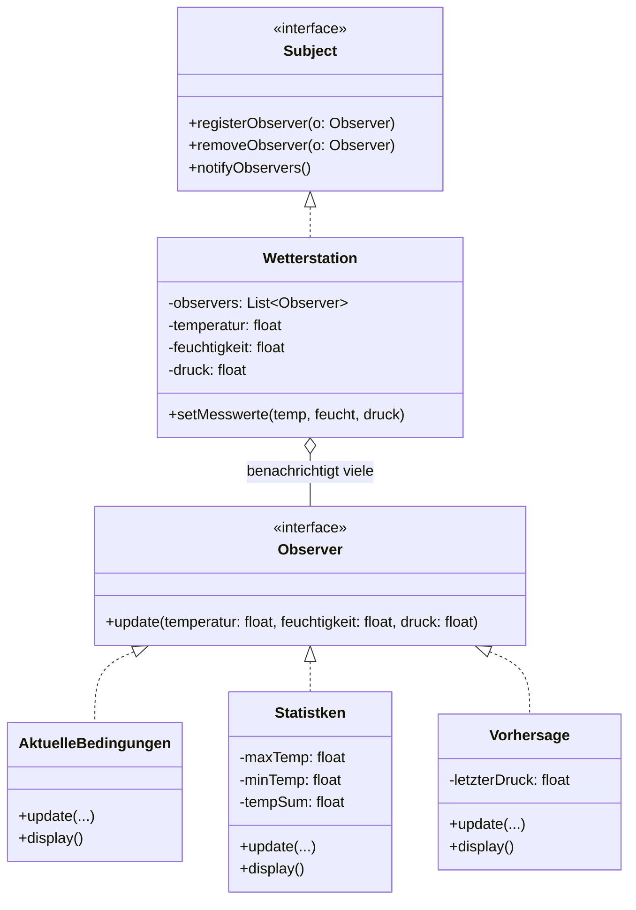

# 🌦️ Wetterstation (Observer Pattern in Java)

Eine saubere, objektorientierte Implementierung des klassischen **Observer Patterns (Beobachter-Muster)** nach dem Standardwerk *Head First Design Patterns*.

Entwickelt im Rahmen des Gegenstands **Softwareentwicklung (SEW)** an der HTL TGM Wien (4. Jahrgang, 1. Semester).

---

## 🏛 Architektur & Entwurfsmuster

Das System trennt die Datenerfassung (Messstation) vollständig von der Datenanzeige (verschiedene Displays):



- **Subject (`Subject.java`)**: Interface für die Messstation (`registerObserver`, `removeObserver`, `notifyObservers`).
- **Konkretes Subject (`Wetterstation.java`)**: Verwaltet Messwerte für Temperatur, Luftfeuchtigkeit und Luftdruck. Bei neuen Messdaten werden alle registrierten Displays automatisch informiert.
- **Observer (`Observer.java`)**: Callback-Interface für alle Anzeigeelemente (`update(...)`).
- **Konkrete Observer**:
  - `AktuelleBedingungen.java`: Zeigt die aktuellen Live-Messwerte an.
  - `Statistken.java`: Berechnet Durchschnitts-, Minimal- und Maximaltemperaturen.
  - `Vorhersage.java`: Berechnet eine Wettertendenz basierend auf Luftdruckveränderungen.

---

## ✨ Features

- **Loose Coupling (Lose Kopplung)**: Die Wetterstation kennt nur das `Observer`-Interface, keine konkreten Display-Klassen.
- **Dynamische Registrierung**: Displays können zur Laufzeit hinzugefügt oder abgemeldet werden.
- **UML-Diagramm**: Vollständiges Astah Modell liegt bei (`Wetterstation_UML.asta`).

---

## 📁 Projektstruktur

```
observer-pattern-wetterstation/
├── README.md                   # Projektdokumentation
├── Wetterstation_UML.asta      # Astah UML-Klassendiagramm
└── src/                        # Quellcode
    ├── Subject.java            # Publisher-Interface
    ├── Wetterstation.java      # Publisher-Implementierung
    ├── Observer.java           # Subscriber-Interface
    ├── AktuelleBedingungen.java # Display: Live-Daten
    ├── Statistken.java         # Display: Statistische Auswertung
    ├── Vorhersage.java         # Display: Trendprognose
    └── Main.java               # Einstiegspunkt & Simulation
```

---

## 🚀 Ausführung

```bash
# Kompilieren
javac -d out/production/src src/*.java

# Starten
java -cp out/production/src Main
```

---

## 👤 Autor

**Timon Hollaus**  
HTL TGM Wien – Abteilung für Informationstechnologie
